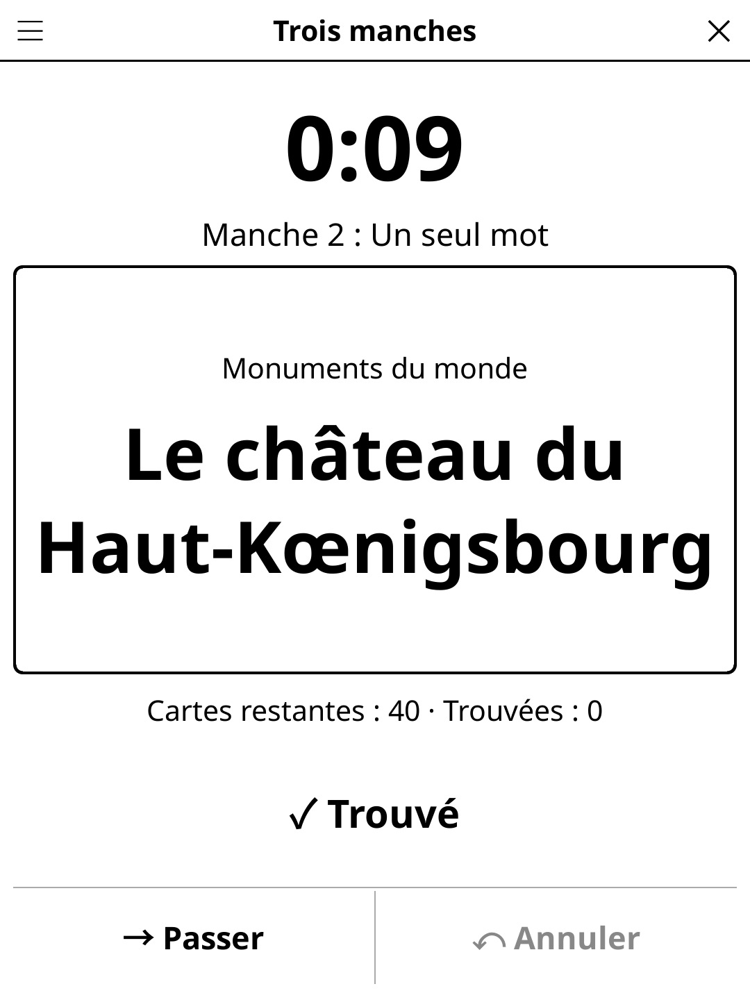

# threerounds.koplugin

**Three Rounds** (French: *Trois manches*) for [KOReader](https://github.com/koreader/koreader) — a team guessing party game played in three rounds with the same deck of famous names, on one e-reader passed between teams.

## Screenshot



## Concept

Two to four teams. A deck of 30, 40 or 60 cards is dealt — mostly proper nouns: Einstein, Cléopâtre, Mozart, Marie Curie, Astérix, Sherlock Holmes, Dark Vador, the Taj Mahal… The same deck is played three times:

1. **Describe freely** — anything but the name itself.
2. **One word only** — a single word per card.
3. **Mime only** — gestures and sounds, no words.

On a turn, one player of the active team holds the reader and makes their team guess as many cards as possible before the timer ends: a huge **Found** button (+1, the card leaves the pool), **Pass** (the card goes to the bottom of the pool — rounds 2 and 3 only by default) and **Undo** for a slip of the finger. When the timer ends, a neutral hand-over screen asks to pass the reader to the next team; nothing is shown until **Ready** is tapped. When the pool is empty the round is over and the next one starts with the same cards. After round 3, the final table shows each team's score per round and in total, with **New game** in the action bar.

## Features

- 2,774 French and 2,021 English cards in 14 themes (historical figures, scientists & explorers, inventions, arts & letters, music, fictional characters, film & TV, countries & cities, monuments of the world, sports stars, myths & legends, food & dishes, famous animals — Milou, Rantanplan, Laïka, Jolly Jumper… — and an easy kids' theme left out by default), each with at least 110 cards, chosen in a multi-select **Themes** menu that shows each theme's size. Only the selected language's file is loaded (about 170 KB of Lua heap for the French deck). French cards are French-flavoured (Vercingétorix, Molière, Louis de Funès, le Mont-Saint-Michel…), English ones British/American-flavoured.
- Cards already dealt are remembered across games: a card comes back only once every card of the selected themes has been played.
- Turn timer 30/45/60 s; only the digits refresh, once a second.
- Passing configurable: rounds 2–3 (default), all rounds, never.
- Team names typed once and remembered.
- Content language (FR/EN) independent of the interface language (English, French, Spanish, German).
- The game is saved when the screen is closed; a turn cut short comes back as the hand-over screen for the same team (its points stay).

## Settings (title-bar menu)

New game · Language · Teams (2–4) · Team names · Cards (30/40/60) · Timer · Passing · Themes · Rules

## Installation

1. Download `threerounds.zip` from [Releases](../../releases).
2. Extract to your KOReader `plugins/` directory (the shared `game-common` library must be installed too).
3. Restart KOReader — **Three Rounds** appears in the Tools menu.

## Development

`threerounds.koplugin/` lives inside the
[koreader-plugins](https://github.com/t2ym5u/koreader-plugins) monorepo. Game logic is in `game.lua` (no UI);
the cards are plain Lua tables in `cards_fr.lua` / `cards_en.lua`. Specs:

```
busted test_game_spec.lua
```

## License

GPL-3.0
